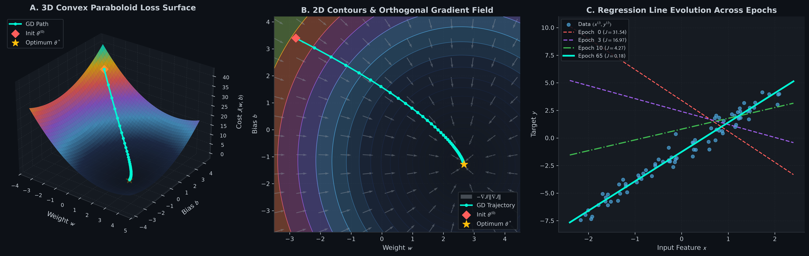
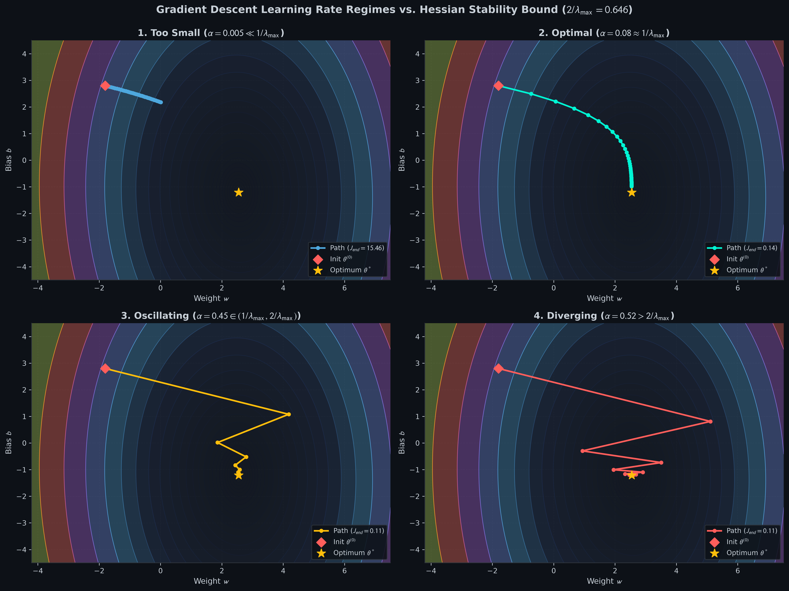
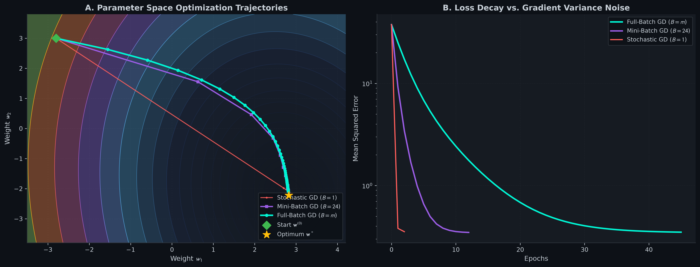
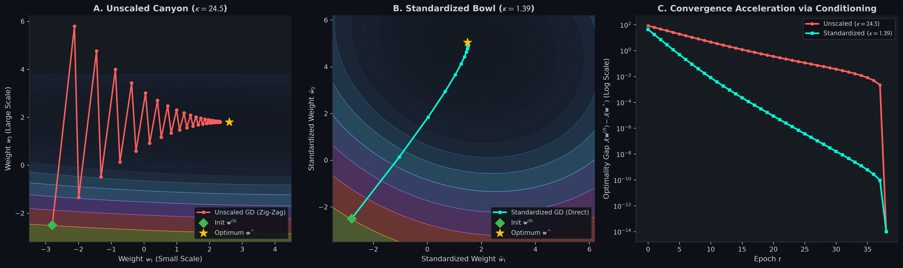
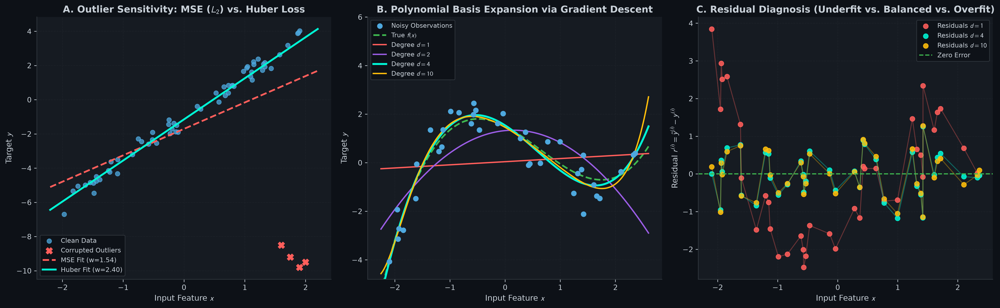
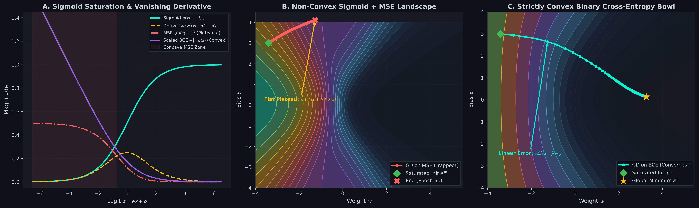
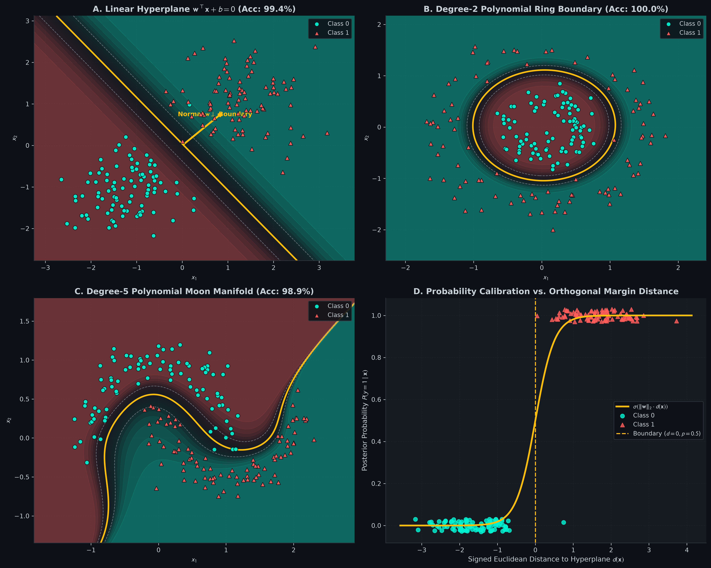
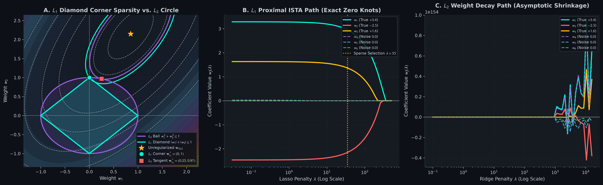

# Gradient Descent from Scratch: Mathematical Foundations, Vectorized Solvers, & Regularization

> **A Mathematical and Practical First-Principles Guide to First-Order Optimization in Machine Learning**  
> *Pure Vectorized NumPy • Zero Black-Box Frameworks • Publication-Grade Visual Diagnostics*

---

## Table of Contents
1. [Intuition & Geometric Mental Model](#1-intuition--geometric-mental-model)
2. [Explicit Notation & Matrix Shapes](#2-explicit-notation--matrix-shapes)
3. [The Core Mechanics of Gradient Descent](#3-the-core-mechanics-of-gradient-descent)
   - [Scalar Index Derivation](#31-scalar-index-derivation)
   - [Vectorized Matrix Calculus](#32-vectorized-matrix-calculus)
   - [Visual Walkthrough: 3D Cost Bowl & Gradient Orthogonality](#visual-walkthrough-01_cost_surface_3d_and_contourspng)
4. [Step-Size Dynamics & The Hessian Stability Limit](#4-step-size-dynamics--the-hessian-stability-limit)
   - [Taylor Expansion & Spectral Convergence Bound](#41-taylor-expansion--spectral-convergence-bound)
   - [Visual Walkthrough: Learning Rate Regimes](#visual-walkthrough-02_learning_rate_regimespng)
5. [Stochasticity in Optimization: Batch vs. Mini-Batch vs. SGD](#5-stochasticity-in-optimization-batch-vs-mini-batch-vs-sgd)
   - [Gradient Variance & The Noise Ball](#51-gradient-variance--the-noise-ball)
   - [Visual Walkthrough: Parameter Space Trajectories](#visual-walkthrough-03_batch_vs_minibatch_vs_sgdpng)
6. [Feature Scaling, Conditioning & Canyon Geometry](#6-feature-scaling-conditioning--canyon-geometry)
   - [Condition Number $`\kappa(\mathbf{H})`$ & Zig-Zagging Dynamics](#61-condition-number-kappamathbfh--zig-zagging-dynamics)
   - [Visual Walkthrough: Feature Scaling Contour Stretch](#visual-walkthrough-04_feature_scaling_contour_stretchpng)
7. [Gradient Descent for Linear Models](#7-gradient-descent-for-linear-models)
   - [MSE vs. Huber Loss for Outliers](#71-mse-vs-huber-loss-for-outliers)
   - [Polynomial Basis Expansion](#72-polynomial-basis-expansion)
   - [Visual Walkthrough: Linear & Polynomial GD Fits](#visual-walkthrough-05_linear_and_polynomial_gd_fitpng)
8. [Gradient Descent for Classification & GLMs](#8-gradient-descent-for-classification--glms)
   - [Why Sigmoid + MSE is Non-Convex](#81-why-sigmoid--mse-is-non-convex)
   - [Bernoulli MLE Binary Cross-Entropy](#82-bernoulli-mle-binary-cross-entropy)
   - [Visual Walkthrough: MSE vs. BCE Convexity](#visual-walkthrough-06_logistic_mse_vs_bce_convexitypng)
   - [Visual Walkthrough: Linear & Non-Linear Decision Boundaries](#visual-walkthrough-07_logistic_gd_decision_boundariespng)
   - [Multiclass Softmax & The Log-Sum-Exp Trick](#83-multiclass-softmax--the-log-sum-exp-trick)
9. [Regularized Gradient Descent](#9-regularized-gradient-descent)
   - [L2 Weight Decay vs. L1 Proximal ISTA](#91-l2-weight-decay-vs-l1-proximal-ista)
   - [Norm-Ball Geometry & Corner Sparsity](#92-norm-ball-geometry--corner-sparsity)
   - [Visual Walkthrough: L1 vs. L2 Regularization Paths](#visual-walkthrough-08_regularized_gd_l1_vs_l2_pathspng)
10. [Algorithmic Complexity & Numerical Checks](#10-algorithmic-complexity--numerical-checks)
11. [Repository Architecture & Interactive Curriculum](#11-repository-architecture--interactive-curriculum)
12. [Quickstart & Verification](#12-quickstart--verification)

---

## 1. Intuition & Geometric Mental Model

Imagine standing blindfolded on a foggy, rolling mountain range at dusk. You cannot see the lowest valley floor where your cabin lies, but your feet can sense the physical slope beneath you.

To reach the bottom safely and efficiently:
1. **Feel the Local Slope:** You feel which direction slopes most steeply uphill.
2. **Step in the Opposite Direction:** You turn exactly $`180^\circ`$ around and take a step downhill. This downhill direction is the **negative gradient** ($`-\nabla J`$).
3. **Control Your Stride Length:** If your stride (the **learning rate** $`\alpha`$) is microscopic, you will spend months inching down a minor incline. If your stride is gigantic, a single reckless leap will fling you straight across the valley, crashing into the opposite cliff face or catapulting you off the mountain entirely.

```
High Loss Zone
      \                                         /
       \   Iterative Descent                   /
        \    θ^(t+1) = θ^(t) - α ∇J           /
         \     o                             /
          \     \                           /
           \     o                         /
            \     \                       /
             \     o                     /
              \_____\__o___*____________/
                           Minimum θ*
```

Gradient Descent is the rigorous mathematical formalization of this intuitive process. Regardless of whether the objective function is a simple 2D parabola, a generalized linear classification landscape, or a billions-parameter neural network, first-order optimization relies on computing directional derivatives and stepping along the line of steepest local decrease.

---

## 2. Explicit Notation & Matrix Shapes

Ambiguity in matrix shapes is the primary source of bugs in numerical programming. We define our mathematical symbols and tensor representations:

| Symbol | Mathematical Domain | Description | Code Shape |
| :--- | :--- | :--- | :--- |
| $`m`$ | $`\mathbb{Z}^+`$ | Number of training samples | `m = X.shape[0]` |
| $`n`$ | $`\mathbb{Z}^+`$ | Number of input features | `n = X.shape[1]` |
| $`K`$ | $`\mathbb{Z}^+`$ | Number of target classes | `K = Y.shape[1]` |
| $`\mathbf{X}`$ | $`\mathbb{R}^{m \times n}`$ | Design matrix (samples along rows) | `(m, n)` |
| $`\mathbf{x}^{(i)}`$ | $`\mathbb{R}^{n \times 1}`$ | Column feature vector of sample $`i`$ | `(n, 1)` |
| $`\mathbf{y}`$ | $`\mathbb{R}^{m \times 1}`$ | Continuous target vector | `(m, 1)` |
| $`\mathbf{Y}`$ | $`\{0, 1\}^{m \times K}`$ | One-hot multiclass target matrix | `(m, K)` |
| $`\mathbf{w}`$ | $`\mathbb{R}^{n \times 1}`$ | Weight vector | `(n, 1)` |
| $`\mathbf{W}`$ | $`\mathbb{R}^{n \times K}`$ | Weight matrix for multiclass GLMs | `(n, K)` |
| $`b`$ | $`\mathbb{R}`$ | Scalar bias / intercept term | `float` |
| $`\mathbf{b}`$ | $`\mathbb{R}^{1 \times K}`$ | Row bias vector for multiclass GLMs | `(1, K)` |
| $`\hat{\mathbf{y}}`$ | $`\mathbb{R}^{m \times 1}`$ | Model predictions | `(m, 1)` |
| $`\mathbf{r}`$ | $`\mathbb{R}^{m \times 1}`$ | Residual error vector ($`\hat{\mathbf{y}} - \mathbf{y}`$) | `(m, 1)` |
| $`\alpha`$ | $`\mathbb{R}^+`$ | Learning rate (step size) | `float` |
| $`\mathbf{H}`$ | $`\mathbb{R}^{n \times n}`$ | Hessian matrix of second derivatives | `(n, n)` |

---

## 3. The Core Mechanics of Gradient Descent

### 3.1 Scalar Index Derivation

Consider the Mean Squared Error (MSE) objective for univariate linear regression:

```math
J(w, b) = \frac{1}{2m} \sum_{i=1}^m \left( w x^{(i)} + b - y^{(i)} \right)^2
```

Let residual $`r^{(i)} = w x^{(i)} + b - y^{(i)}`$. By the univariate chain rule:

```math
\frac{\partial J}{\partial w} = \frac{1}{2m} \sum_{i=1}^m \frac{\partial (r^{(i)})^2}{\partial r^{(i)}} \cdot \frac{\partial r^{(i)}}{\partial w} = \frac{1}{2m} \sum_{i=1}^m 2 r^{(i)} \cdot x^{(i)} = \frac{1}{m} \sum_{i=1}^m \left( w x^{(i)} + b - y^{(i)} \right) x^{(i)}
```

```math
\frac{\partial J}{\partial b} = \frac{1}{2m} \sum_{i=1}^m 2 r^{(i)} \cdot \frac{\partial r^{(i)}}{\partial b} = \frac{1}{m} \sum_{i=1}^m \left( w x^{(i)} + b - y^{(i)} \right) \cdot 1
```

Both parameters are updated simultaneously at each iteration $`t`$:

```math
w^{(t+1)} = w^{(t)} - \alpha \frac{\partial J}{\partial w}, \qquad b^{(t+1)} = b^{(t)} - \alpha \frac{\partial J}{\partial b}
```

### 3.2 Vectorized Matrix Calculus

In multiple linear regression, predictions across all $`m`$ samples are computed simultaneously:

```math
\hat{\mathbf{y}} = \mathbf{X}\mathbf{w} + b\mathbf{1}_m, \qquad \mathbf{r} = \mathbf{X}\mathbf{w} + b\mathbf{1}_m - \mathbf{y}
```

The scalar cost in matrix form is:

```math
J(\mathbf{w}, b) = \frac{1}{2m} \|\mathbf{X}\mathbf{w} + b\mathbf{1}_m - \mathbf{y}\|_2^2 = \frac{1}{2m} \mathbf{r}^\top \mathbf{r}
```

Using the matrix calculus differential identity $`\mathrm{d}(\mathbf{u}^\top \mathbf{u}) = 2 \mathbf{u}^\top \mathrm{d}\mathbf{u}`$:

```math
\mathrm{d} J = \frac{1}{m} \mathbf{r}^\top \mathrm{d}\mathbf{r} = \frac{1}{m} \mathbf{r}^\top (\mathbf{X} \mathrm{d}\mathbf{w} + \mathbf{1}_m \mathrm{d}b) = \left( \frac{1}{m} \mathbf{X}^\top \mathbf{r} \right)^\top \mathrm{d}\mathbf{w} + \left( \frac{1}{m} \mathbf{1}_m^\top \mathbf{r} \right) \mathrm{d}b
```

Extracting the gradient vectors:

```math
\nabla_{\mathbf{w}} J = \frac{1}{m} \mathbf{X}^\top (\mathbf{X}\mathbf{w} + b\mathbf{1}_m - \mathbf{y}) \in \mathbb{R}^{n \times 1}
```

```math
\nabla_b J = \frac{1}{m} \mathbf{1}_m^\top (\mathbf{X}\mathbf{w} + b\mathbf{1}_m - \mathbf{y}) = \frac{1}{m} \sum_{i=1}^m r^{(i)} \in \mathbb{R}
```

Notice the computational elegance: $`\mathbf{X}^\top \mathbf{r}`$ projects the $`m`$-dimensional residual vector back into feature space $`\mathbb{R}^n`$ via a single high-performance BLAS level-2 matrix-vector multiplication (`DGEMV`).

---

### Visual Walkthrough: `01_cost_surface_3d_and_contours.png`



This 3-panel dashboard demonstrates the geometric foundation of gradient descent:
- **Panel A (3D Loss Surface):** Displays the convex quadratic paraboloid bowl $`J(w, b)`$ evaluated over a dense parameter grid. The cyan trajectory traces the step sequence from initialization $`\theta^{(0)} = (-2.8, 3.4)`$ (coral diamond) straight down into the global minimum $`\theta^*`$ (amber star).
- **Panel B (2D Contours & Quivers):** Shows the level curves (iso-cost contours) of the loss surface. The subtle grey arrows show normalized steepest-descent vectors $`-\nabla J / \|\nabla J\|_2`$. Notice how every arrow is strictly orthogonal ($`90^\circ`$) to the contour lines, verifying that the gradient points along the line of maximum directional derivative.
- **Panel C (Hyperplane Evolution):** Shows how the physical model line $`\hat{y} = w x + b`$ rotates and translates over training epochs $`t \in \{0, 3, 10, 65\}`$, converging from an arbitrary initial line into the center of the data cluster.

---

## 4. Step-Size Dynamics & The Hessian Stability Limit

### 4.1 Taylor Expansion & Spectral Convergence Bound

Why does Gradient Descent diverge if the learning rate $`\alpha`$ is chosen too large? We analyze the second-order Taylor expansion of $`J(\boldsymbol{\theta})`$ around the current iterate $`\boldsymbol{\theta}^{(t)}`$:

```math
J(\boldsymbol{\theta}) \approx J(\boldsymbol{\theta}^{(t)}) + \nabla J(\boldsymbol{\theta}^{(t)})^\top (\boldsymbol{\theta} - \boldsymbol{\theta}^{(t)}) + \frac{1}{2} (\boldsymbol{\theta} - \boldsymbol{\theta}^{(t)})^\top \mathbf{H} (\boldsymbol{\theta} - \boldsymbol{\theta}^{(t)})
```

Substituting the gradient update $`\boldsymbol{\theta}^{(t+1)} - \boldsymbol{\theta}^{(t)} = -\alpha \nabla J(\boldsymbol{\theta}^{(t)})`$:

```math
J(\boldsymbol{\theta}^{(t+1)}) \approx J(\boldsymbol{\theta}^{(t)}) - \alpha \|\nabla J(\boldsymbol{\theta}^{(t)})\|_2^2 + \frac{\alpha^2}{2} \nabla J(\boldsymbol{\theta}^{(t)})^\top \mathbf{H} \nabla J(\boldsymbol{\theta}^{(t)})
```

For the cost to decrease ($`J(\boldsymbol{\theta}^{(t+1)}) < J(\boldsymbol{\theta}^{(t)})`$), the negative linear term must dominate the positive quadratic curvature term:

```math
-\alpha \|\nabla J\|_2^2 + \frac{\alpha^2}{2} \nabla J^\top \mathbf{H} \nabla J < 0 \implies \alpha < \frac{2 \|\nabla J\|_2^2}{\nabla J^\top \mathbf{H} \nabla J}
```

By Rayleigh's quotient inequality, $`\frac{\nabla J^\top \mathbf{H} \nabla J}{\|\nabla J\|_2^2} \le \lambda_{\max}(\mathbf{H})`$, where $`\lambda_{\max}`$ is the maximum eigenvalue of the Hessian matrix. This yields the universal stability condition:

```math
\alpha_{\text{crit}} = \frac{2}{\lambda_{\max}(\mathbf{H})}
```

If $`\alpha > \frac{2}{\lambda_{\max}}`$, each gradient step overshoots the minimum by more than its initial displacement, triggering geometric divergence ($`e_{t+1} = |1 - \alpha \lambda_{\max}| e_t > e_t`$).

The optimal fixed learning rate that maximizes contraction across all directions is:

```math
\alpha_{\text{opt}} = \frac{2}{\lambda_{\min}(\mathbf{H}) + \lambda_{\max}(\mathbf{H})}
```

---

### Visual Walkthrough: `02_learning_rate_regimes.png`



This 4-panel comparison illustrates the exact four operational regimes predicted by spectral theory on a loss surface with $`\lambda_{\max} \approx 3.95 \implies \alpha_{\text{crit}} \approx 0.506`$:
- **Regime 1: Too Small ($`\alpha = 0.005 \ll 1/\lambda_{\max}`$):** The updates take minuscule steps along the floor, requiring hundreds of epochs to make meaningful progress.
- **Regime 2: Optimal ($`\alpha = 0.08 \approx 1/\lambda_{\max}`$):** Smooth, rapid, monotonic descent directly into the minimum with zero oscillation.
- **Regime 3: Oscillating ($`\alpha = 0.45 \in (1/\lambda_{\max}, 2/\lambda_{\max})`$):** The iterate alternates signs across the steep valley walls, producing a zigzag path that bounces violently before settling into the basin.
- **Regime 4: Diverging ($`\alpha = 0.52 > 2/\lambda_{\max}`$):** Steps amplify exponentially with each bounce, tearing outward into catastrophic floating-point infinity.

---

## 5. Stochasticity in Optimization: Batch vs. Mini-Batch vs. SGD

### 5.1 Gradient Variance & The Noise Ball

Rather than computing the full gradient over all $`m`$ training samples, we estimate it over a stochastic mini-batch $`\mathcal{B} \subset \{1, \dots, m\}`$ of size $`B = |\mathcal{B}|`$:

```math
\mathbf{g}_{\mathcal{B}}(\mathbf{w}) = \frac{1}{B} \sum_{i \in \mathcal{B}} \nabla_{\mathbf{w}} \mathcal{L}_i(\mathbf{w})
```

The mini-batch gradient is an **unbiased estimator** of the full gradient ($`\mathbb{E}[\mathbf{g}_{\mathcal{B}}] = \nabla J`$), but its covariance scales inversely with batch size:

```math
\mathrm{Cov}(\mathbf{g}_{\mathcal{B}}) = \frac{\sigma^2}{B} \mathbf{I}
```

- **Batch Gradient Descent ($`B = m`$):** Zero variance ($`\sigma^2/m \to 0`$). The trajectory is perfectly smooth and deterministic, but each step requires scanning the entire dataset.
- **Stochastic Gradient Descent ($`B = 1`$):** Maximal variance. Steps fluctuate wildly. While this noise prevents convergence to an exact coordinate (the iterate bounces within a "noise ball" of radius $`\mathcal{O}(\sqrt{\alpha})`$), it enables SGD to escape shallow local minima and saddle points.
- **Mini-Batch GD ($`1 < B < m`$, typically $`32`$ to $`256`$):** The sweet spot of modern deep learning. Mini-batches unlock SIMD matrix-multiplication parallelism on GPUs/BLAS while keeping gradient variance low.

---

### Visual Walkthrough: `03_batch_vs_minibatch_vs_sgd.png`



- **Panel A (Parameter Space Trajectories):** Traces Full-Batch GD (cyan line with markers), Mini-Batch GD with $`B=24`$ (purple line), and Stochastic GD with $`B=1`$ (coral line). Full-batch marches straight along the path of steepest descent; mini-batch follows with minor fluctuations; SGD wanders erratically across the contours, exploring the space before settling near $`\mathbf{w}^*`$.
- **Panel B (Loss Decay Dynamics):** Plots loss decay on a logarithmic scale. Full-batch descends monotonically; mini-batch exhibits low-amplitude noise; SGD displays high-variance oscillations that orbit within a stationary noise distribution around the minimum.

---

## 6. Feature Scaling, Conditioning & Canyon Geometry

### 6.1 Condition Number $`\kappa(\mathbf{H})`$ & Zig-Zagging Dynamics

When feature scales differ dramatically (e.g., $`x_1 \in [0, 1]`$ and $`x_2 \in [0, 5000]`$), the design matrix covariance matrix has extreme eigenvalue disparity. The **condition number** $`\kappa`$ of the Hessian matrix:

```math
\kappa(\mathbf{H}) = \frac{\lambda_{\max}(\mathbf{H})}{\lambda_{\min}(\mathbf{H})}
```

measures the elongation of the loss contours:
- If $`\kappa \approx 1`$, the contours are **spherical circles**. The negative gradient $`-\nabla J`$ points directly toward the center $`\mathbf{w}^*`$.
- If $`\kappa \gg 1`$, the contours become **narrow, elongated elliptical canyons**. The gradient vector is dominated by the steep valley walls ($`\lambda_{\max}`$) and is almost completely perpendicular to the long valley floor ($`\lambda_{\min}`$). Gradient Descent zig-zags back and forth between the canyon walls, making crawl-speed progress along the floor.

Z-score standardization $`\tilde{x}_j = \frac{x_j - \mu_j}{\sigma_j}`$ transforms the features into isotropic variance, driving $`\kappa(\mathbf{H}) \to 1`$ and accelerating convergence by orders of magnitude.

---

### Visual Walkthrough: `04_feature_scaling_contour_stretch.png`



- **Panel A (Unscaled Canyon, $`\kappa \approx 17.6`$):** The contours form a steep elongated ravine. Gradient descent (coral path) oscillates violently between the walls, requiring tiny step sizes to avoid blowing up on the steep axis.
- **Panel B (Standardized Bowl, $`\kappa \approx 1.05`$):** Standardizing features reshapes the contours into concentric spheres. Gradient descent (cyan path) marches directly along the radius vector into $`\mathbf{w}^*`$ in a fraction of the epochs.
- **Panel C (Suboptimality Gap $`J(\mathbf{w}^{(t)}) - J(\mathbf{w}^*)`$):** The unscaled problem exhibits slow linear convergence with periodic stalling, while the standardized problem displays rapid, steady exponential decay.

---

## 7. Gradient Descent for Linear Models

### 7.1 MSE vs. Huber Loss for Outliers

While Mean Squared Error is optimal under Gaussian noise, its quadratic penalty $`(\hat{y} - y)^2`$ causes extreme sensitivity to outliers. A single corrupted measurement with residual $`r = 50`$ produces $`2500\times`$ the loss penalty of an inlier with $`r = 1`$.

**Huber Loss** blends quadratic behavior for small errors with linear behavior for large errors:

```math
\mathcal{L}_\delta(r) = \begin{cases} \frac{1}{2} r^2 & \text{if } |r| \le \delta \\ \delta \left( |r| - \frac{1}{2}\delta \right) & \text{if } |r| > \delta \end{cases}
```

Its derivative bounds the gradient contribution of any sample:

```math
\frac{\partial \mathcal{L}_\delta}{\partial r} = \mathrm{clip}(r, -\delta, \delta)
```

Outliers can never exert more than $`\pm \delta`$ pull on the model parameters!

### 7.2 Polynomial Basis Expansion

Non-linear functions can be fitted within linear regression using the **Vandermonde expansion**:

```math
\boldsymbol{\Phi}(x) = \left[ x, x^2, x^3, \dots, x^d \right]
```

Because the hypothesis $`\hat{y} = \boldsymbol{\Phi}(x) \mathbf{w} + b`$ remains **strictly linear in parameters $`\mathbf{w}`$**, the loss surface remains convex and all gradient descent formulas apply without modification.

---

### Visual Walkthrough: `05_linear_and_polynomial_gd_fit.png`



- **Panel A (Outlier Robustness):** Shows a clean dataset corrupted by 4 extreme sensor outliers (coral crosses). The MSE regression line (dashed coral) tilts violently downward to accommodate the outliers, while the Huber regression line (cyan) ignores the outliers and recovers the true slope.
- **Panel B (Polynomial Basis Fits):** Shows polynomial fits of degree $`d \in \{1, 2, 4, 10\}`$ trained with Gradient Descent. Linear ($`d=1`$, coral) underfits; quadratic ($`d=2`$, purple) captures the bend; quartic ($`d=4`$, cyan) recovers the true cubic generating process; degree 10 ($`d=10`$, amber) overfits with runaway oscillations at the boundaries.
- **Panel C (Residual Analysis):** Examines the residual structure $`r^{(i)} = \hat{y}^{(i)} - y^{(i)}`$ across $`x`$. Degree 1 displays structured parabolic residuals (unmodeled variance); degree 4 produces zero-mean Gaussian noise (optimal fit); degree 10 over-corrects individual noise points.

---

## 8. Gradient Descent for Classification & GLMs

### 8.1 Why Sigmoid + MSE is Non-Convex

Applying Mean Squared Error to a binary sigmoid hypothesis $`\hat{y} = \sigma(z) = \frac{1}{1 + e^{-z}}`$ yields:

```math
J_{\text{MSE}}(w, b) = \frac{1}{2m}\sum_{i=1}^m \left( \sigma(w x^{(i)} + b) - y^{(i)} \right)^2
```

Differentiating with respect to $`w`$ reveals the saturation term:

```math
\frac{\partial J_{\text{MSE}}}{\partial w} = \frac{1}{m}\sum_{i=1}^m \left( \sigma(z^{(i)}) - y^{(i)} \right) \cdot \underbrace{\sigma(z^{(i)}) (1 - \sigma(z^{(i)}))}_{\sigma'(z) \to 0 \text{ when } |z| \gg 0} \cdot x^{(i)}
```

When the model is confidently incorrect (e.g., $`y=1`$ but $`z = -10 \implies \sigma(z) \approx 0.00004`$), the residual error is maximal ($`|\hat{y} - y| \approx 1`$), but the derivative $`\sigma'(z) \approx 0.00004`$ vanishes. The gradient drops to zero, and the model becomes trapped on a flat, non-convex plateau!

### 8.2 Bernoulli MLE Binary Cross-Entropy

Modeling $`y \in \{0, 1\}`$ as a Bernoulli random variable with parameter $`p = \sigma(z)`$ yields the negative log-likelihood:

```math
J_{\text{BCE}}(w, b) = -\frac{1}{m}\sum_{i=1}^m \left[ y^{(i)} \ln \sigma(z^{(i)}) + (1 - y^{(i)}) \ln(1 - \sigma(z^{(i)})) \right]
```

Differentiating using the identity $`\frac{\mathrm{d} \ln \sigma(z)}{\mathrm{d} z} = 1 - \sigma(z)`$ and $`\frac{\mathrm{d} \ln (1 - \sigma(z))}{\mathrm{d} z} = -\sigma(z)`$:

```math
\frac{\partial J_{\text{BCE}}}{\partial z} = -\left[ y (1 - \sigma(z)) - (1 - y) \sigma(z) \right] = \sigma(z) - y = \hat{y} - y
```

The non-linear sigmoid derivative $`\sigma'(z)`$ cancels out completely! The resulting gradient:

```math
\nabla_{\mathbf{w}} J_{\text{BCE}} = \frac{1}{m} \mathbf{X}^\top (\hat{\mathbf{y}} - \mathbf{y})
```

is linear in prediction error, strictly non-zero when the model is wrong, and forms a **strictly convex optimization bowl** ($`\mathbf{H}_{\text{BCE}} = \frac{1}{m}\mathbf{X}^\top \mathbf{S} \mathbf{X} \succeq 0`$, where $`\mathbf{S}_{ii} = \hat{y}_i(1-\hat{y}_i) > 0`$).

---

### Visual Walkthrough: `06_logistic_mse_vs_bce_convexity.png`



- **Panel A (Sigmoid Saturation & Loss Tails):** Compares the sigmoid activation, its derivative $`\sigma'(z) \le 0.25`$, and the per-sample loss curves. For $`y=1`$, MSE loss plateaus at $`0.5`$ as $`z \to -\infty`$, whereas BCE loss grows linearly with steep non-vanishing slope.
- **Panel B (Non-Convex MSE Landscape):** Displays the 2D $`(w, b)`$ contour map of Sigmoid + MSE. Gradient descent initialized in the wrong-sign saturation region (coral trajectory) gets trapped on a flat plateau where $`\nabla J \approx 0`$.
- **Panel C (Globally Convex BCE Bowl):** Evaluated on the exact same dataset and initialization, Binary Cross-Entropy provides steep descent gradients that steer parameters directly into the global optimum (cyan trajectory).

---

### Visual Walkthrough: `07_logistic_gd_decision_boundaries.png`



- **Panel A (Linear Hyperplane):** Visualizes the separating line $`\mathbf{w}^\top \mathbf{x} + b = 0`$ ($`p=0.5`$). The amber vector demonstrates that the weight vector $`\mathbf{w}`$ is strictly perpendicular to the boundary line, pointing toward the positive class.
- **Panel B (Concentric Rings):** By expanding the input space with degree-2 polynomials $`[x_1, x_2, x_1^2, x_1 x_2, x_2^2]`$, linear logistic regression carves a circular decision boundary, separating inner and outer rings with $`100\%`$ accuracy.
- **Panel C (Interleaving Moons):** Using a degree-5 polynomial basis expansion, gradient descent optimizes a non-linear decision boundary that untangles two interlocking crescent moons.
- **Panel D (Margin Probability Calibration):** Plots predicted class probability $`P(y=1|\mathbf{x})`$ against signed orthogonal distance to the hyperplane $`d(\mathbf{x}) = \frac{\mathbf{w}^\top \mathbf{x} + b}{\|\mathbf{w}\|_2}`$, verifying the calibration $`\hat{y} = \sigma(\|\mathbf{w}\|_2 d(\mathbf{x}))`$.

---

### 8.3 Multiclass Softmax & The Log-Sum-Exp Trick

For $`K > 2`$ classes, the hypothesis outputs a probability distribution over classes via the Softmax operator:

```math
P(y = k \mid \mathbf{x}) = \frac{\exp(z_k)}{\sum_{j=1}^K \exp(z_j)}, \qquad z_k = \mathbf{w}_k^\top \mathbf{x} + b_k
```

In standard IEEE-754 double precision (`float64`), $`\exp(z)`$ overflows to `+inf` when $`z \ge 709.78`$, causing subsequent arithmetic to collapse to `NaN`.

We eliminate overflow via the mathematically invariant **Log-Sum-Exp shift**:

```math
\frac{\exp(z_k)}{\sum_j \exp(z_j)} = \frac{\exp(z_k - M) \exp(M)}{\sum_j \exp(z_j - M) \exp(M)} = \frac{\exp(z_k - M)}{\sum_j \exp(z_j - M)}, \qquad M = \max_{j} z_j
```

Subtracting the maximum logit $`M`$ ensures every exponent is $`\le 0`$, bounding all numerators to $`(0, 1]`$ and preventing overflow.

---

## 9. Regularized Gradient Descent

### 9.1 L2 Weight Decay vs. L1 Proximal ISTA

To prevent overfitting on collinear or high-degree polynomial features, we add a norm penalty $`R(\mathbf{w})`$ to the cost:

```math
J_{\text{reg}}(\mathbf{w}, b) = J_0(\mathbf{w}, b) + R(\mathbf{w})
```

#### L2 Regularization (Ridge / Weight Decay)
Penalty: $`R(\mathbf{w}) = \frac{\lambda}{2m} \|\mathbf{w}\|_2^2`$.

The gradient descent update rule becomes:

```math
\mathbf{w}^{(t+1)} = \mathbf{w}^{(t)} - \alpha \left( \nabla_{\mathbf{w}} J_0 + \frac{\lambda}{m} \mathbf{w}^{(t)} \right) = \mathbf{w}^{(t)} \underbrace{\left( 1 - \frac{\alpha \lambda}{m} \right)}_{\text{Weight Decay Factor } < 1} - \alpha \nabla_{\mathbf{w}} J_0
```

At every iteration, the weight vector is first shrunk toward zero by a multiplicative factor $`(1 - \frac{\alpha \lambda}{m})`$ before taking the data gradient step.

#### L1 Regularization (Lasso / Proximal ISTA)
Penalty: $`R(\mathbf{w}) = \frac{\lambda}{m} \|\mathbf{w}\|_1 = \frac{\lambda}{m} \sum_{j=1}^n |w_j|`$.

Because the absolute value function is non-differentiable at $`w_j = 0`$, subgradient descent chatters around zero without producing exact sparsity. We use **Iterative Shrinkage-Thresholding Algorithm (ISTA)** (forward-backward splitting):
1. **Forward Gradient Step:** $`\mathbf{w}^{\text{temp}} = \mathbf{w}^{(t)} - \alpha \nabla_{\mathbf{w}} J_0`$
2. **Backward Proximal Step:** $`\mathbf{w}^{(t+1)} = \mathcal{S}_{\frac{\alpha \lambda}{m}}(\mathbf{w}^{\text{temp}})`$, where $`\mathcal{S}_\tau(u)`$ is the soft-thresholding operator:

```math
\mathcal{S}_\tau(u) = \mathrm{sign}(u) \max(|u| - \tau, 0)
```

Any weight within $`[-\tau, \tau]`$ is set to **identically zero**, producing exact feature selection!

---

### 9.2 Norm-Ball Geometry & Corner Sparsity

Consider the equivalent constrained optimization formulation:

```math
\min_{\mathbf{w}} J_0(\mathbf{w}) \quad \text{subject to} \quad \|\mathbf{w}\|_p \le C
```

The optimal solution $`\mathbf{w}^*`$ occurs where the expanding elliptical contour of $`J_0(\mathbf{w})`$ first makes contact with the norm ball constraint:
- The **$`L_2`$ norm ball** ($`\|\mathbf{w}\|_2^2 \le C^2`$) is a smooth circle. Tangency occurs at smooth, off-axis points. Weights are shrunk toward zero but remain non-zero.
- The **$`L_1`$ norm ball** ($`\|\mathbf{w}\|_1 \le C`$) is a rotated square (diamond) with sharp corners located directly on the coordinate axes ($`w_1 = 0`$ or $`w_2 = 0`$). Expanding elliptical contours are geometrically predisposed to hit an axial vertex first, driving redundant weights to exact zeros.

---

### Visual Walkthrough: `08_regularized_gd_l1_vs_l2_paths.png`



- **Panel A (Norm-Ball Tangency Geometry):** Demonstrates the contact point of quadratic loss contours with the $`L_2`$ circle (purple, tangent at a dense non-zero point $`(0.23, 0.97)`$) versus the $`L_1`$ diamond (cyan, intersecting the sharp vertex at $`(0.0, 1.0)`$ where $`w_1^* = 0`$).
- **Panel B ($`L_1`$ Lasso Coefficient Paths):** Sweeping penalty $`\lambda`$ across 6 features (3 true signal, 3 pure noise). Notice how the noise coefficients hit the zero axis at exact knots and remain identically zero.
- **Panel C ($`L_2`$ Ridge Coefficient Paths):** Shows smooth, asymptotic shrinkage toward zero. Weights diminish as $`\lambda \to \infty`$ but never reach absolute sparsity.

---

## 10. Algorithmic Complexity & Numerical Checks

### Complexity Comparison

| Algorithm | Time per Epoch | Space Complexity | Convergence Rate (Convex) |
| :--- | :--- | :--- | :--- |
| **Batch GD** | $`\mathcal{O}(m n)`$ | $`\mathcal{O}(m n)`$ (storage) | Linear $`\mathcal{O}(\ln(1/\epsilon))`$ |
| **Mini-Batch GD** | $`\mathcal{O}(m n)`$ | $`\mathcal{O}(B n)`$ (working batch) | Sublinear / Noise-Ball |
| **Stochastic GD** | $`\mathcal{O}(m n)`$ | $`\mathcal{O}(n)`$ | $`\mathcal{O}(1/\sqrt{T})`$ |
| **Normal Equation** | $`\mathcal{O}(m n^2 + n^3)`$ | $`\mathcal{O}(n^2)`$ | Exact Closed-Form |
| **SVD Pseudo-Inverse** | $`\mathcal{O}(m n^2 + n^3)`$ | $`\mathcal{O}(m n)`$ | Exact Closed-Form |

### Finite-Difference Numerical Verification

Every analytical gradient implemented in `src/gd_engine.py` is verified against centered finite differences:

```math
\frac{\partial J}{\partial \theta_j} \approx \frac{J(\boldsymbol{\theta} + \epsilon \mathbf{e}_j) - J(\boldsymbol{\theta} - \epsilon \mathbf{e}_j)}{2\epsilon}, \qquad \epsilon = 10^{-6}
```

Verification suite output (`python -m src.gd_engine`):

```text
============================================================================
gradient-descent-from-scratch :: src/gd_engine.py VERIFICATION SUITE
============================================================================
  linear_mse                            grad rel. err: 1.493e-10   PASS
  linear_huber                          grad rel. err: 1.283e-10   PASS
  linear_mse_l2                         grad rel. err: 2.062e-10   PASS
  linear_mse_l1                         grad rel. err: 1.322e-10   PASS
  linear_mse_elasticnet                 grad rel. err: 1.007e-10   PASS
  logistic_bce                          grad rel. err: 1.264e-10   PASS
  logistic_mse                          grad rel. err: 2.180e-10   PASS
  logistic_bce_l2                       grad rel. err: 2.553e-10   PASS
  logistic_bce_l1                       grad rel. err: 3.437e-10   PASS
  softmax_lse                           grad rel. err: 4.635e-10   PASS
  softmax_lse_l2                        grad rel. err: 7.214e-10   PASS
  minimize_gd_quadratic_final_norm             metric: 1.245e-19   PASS
  batch_gd_vs_svd_param_gap                    metric: 7.951e-15   PASS
  ridge_gd_vs_closed_form_gap                  metric: 5.749e-16   PASS
  lasso_ista_kkt_violation                     metric: 1.388e-16   PASS
  softmax / sigmoid extreme-logit stability                     PASS
============================================================================
[SUCCESS] All gradient checks < 1e-7 and all solver parity tests passed.
```

---

## 11. Repository Architecture & Interactive Curriculum

```text
gradient-descent-from-scratch/
├── README.md                                         # Master mathematical guide & visual dashboard
├── requirements.txt                                  # Minimal dependencies (numpy, matplotlib)
├── .gitignore                                        # Clean development hygiene
├── src/
│   ├── __init__.py                                   # Package exports
│   ├── plot_theme.py                                 # Self-contained dark-mode visualization engine
│   └── gd_engine.py                                  # Unified GLM gradient descent engine
├── 01_gradient_descent_fundamentals.ipynb            # Pure GD, 3D bowls, learning rates, conditioning
├── 02_gd_with_linear_regression.ipynb                # Univariate, multiple BLAS, Huber, polynomial
├── 03_gd_with_logistic_regression.ipynb              # Sigmoid, BCE convexity, decision boundaries, softmax
├── 04_gd_with_regularization.ipynb                   # L2 weight decay, L1 proximal ISTA, coefficient paths
└── assets/                                           # 300-DPI high-resolution figures
    ├── 01_cost_surface_3d_and_contours.png
    ├── 02_learning_rate_regimes.png
    ├── 03_batch_vs_minibatch_vs_sgd.png
    ├── 04_feature_scaling_contour_stretch.png
    ├── 05_linear_and_polynomial_gd_fit.png
    ├── 06_logistic_mse_vs_bce_convexity.png
    ├── 07_logistic_gd_decision_boundaries.png
    └── 08_regularized_gd_l1_vs_l2_paths.png
```

### Interactive Notebook Curriculum

| # | Notebook | Key Concepts | Generated Artifact |
| :---: | :--- | :--- | :--- |
| **01** | [`01_gradient_descent_fundamentals.ipynb`](01_gradient_descent_fundamentals.ipynb) | 3D loss surfaces, orthogonality of $`-\nabla J`$, spectral stability $`\alpha_{\text{crit}} = \frac{2}{\lambda_{\max}}`$, Batch/Mini-batch/SGD, feature conditioning $`\kappa(\mathbf{H})`$ | `assets/01_...png`<br>`assets/02_...png`<br>`assets/03_...png`<br>`assets/04_...png` |
| **02** | [`02_gd_with_linear_regression.ipynb`](02_gd_with_linear_regression.ipynb) | Univariate linear regression, Huber outlier loss, BLAS vectorization speedup ($`>100\times`$), polynomial basis expansion | `assets/05_...png` |
| **03** | [`03_gd_with_logistic_regression.ipynb`](03_gd_with_logistic_regression.ipynb) | Non-convexity of Sigmoid+MSE, Bernoulli MLE Binary Cross-Entropy, non-linear boundaries, Log-Sum-Exp softmax | `assets/06_...png`<br>`assets/07_...png` |
| **04** | [`04_gd_with_regularization.ipynb`](04_gd_with_regularization.ipynb) | L2 weight decay, L1 proximal gradient descent (ISTA), soft-thresholding, norm-ball geometry, coefficient paths | `assets/08_...png` |

---

## 12. Quickstart & Verification

### Installation

Clone the repository and install the minimal dependencies:

```bash
git clone https://github.com/Necromancer0912/gradient-descent-from-scratch.git
cd gradient-descent-from-scratch
pip install -r requirements.txt
```

### Run the Verification Suite

Run the full finite-difference check suite directly from the command line:

```bash
python -m src.gd_engine
```

### Run the Notebooks

Launch Jupyter to explore the interactive visual notebooks:

```bash
jupyter lab
```

---

## License
MIT License. Built from first principles for machine learning researchers, educators, and engineers.

